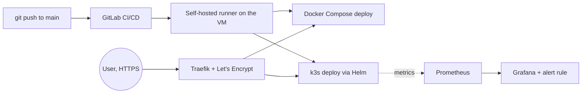

# Django CI/CD Pipeline: Docker, Kubernetes (k3s), Traefik, Prometheus & Grafana

> **In short:** a Django app deployed two ways on one free-tier Oracle Cloud VM (Docker Compose and k3s with a self-written Helm chart), sharing one Traefik reverse proxy with automatic HTTPS. A self-hosted GitLab runner builds and deploys both on every push to `main`, and Prometheus + Grafana monitor the cluster with a custom alert rule. Running cost: 0 EUR/month.
>
> This GitHub repository is a mirror of the GitLab project where the pipeline runs (`.gitlab-ci.yml`). The detailed write-up below is in French.

## Version française

Application web Django déployée de deux façons différentes sur une seule VM Oracle Cloud (offre gratuite) : via Docker Compose classique, et via un cluster Kubernetes (k3s). Les deux déploiements partagent le même reverse proxy (Traefik), avec HTTPS automatique, et sont entièrement automatisés via GitLab CI/CD. Un stack de monitoring complet (Prometheus + Grafana) surveille le cluster.

**Démos en ligne :**
- Déploiement Docker : https://hussain-app.duckdns.org
- Déploiement Kubernetes : https://hussain-k3s.duckdns.org
- Monitoring (Grafana) : https://hussain-grafana.duckdns.org

## Ce que fait ce projet

Chaque fois que je pousse du code sur GitLab, un robot (le "runner") installé sur mon propre serveur teste automatiquement le code, puis le déploie **des deux façons en parallèle** : en reconstruisant le conteneur Docker, et en mettant à jour le déploiement Kubernetes. Aucune connexion manuelle au serveur n'est nécessaire.

## Stack technique

- **Django** — framework web Python pour l'application
- **Docker / Docker Compose** — premier mode de déploiement, conteneurisation simple
- **Kubernetes (k3s)** — second mode de déploiement, orchestration de conteneurs à l'échelle
- **Helm** — gestion des configurations Kubernetes via un chart que j'ai écrit moi-même
- **Traefik** — reverse proxy unique qui route vers les deux déploiements, avec certificats HTTPS automatiques (Let's Encrypt)
- **Prometheus + Grafana** — collecte de métriques et tableaux de bord de monitoring, avec une règle d'alerte personnalisée
- **GitLab CI/CD** — pipeline d'intégration et déploiement continus
- **Runner auto-hébergé** — le pipeline s'exécute sur mon propre serveur, pas sur les machines partagées de GitLab
- **Oracle Cloud (Always Free)** — VM ARM (Ampere A1), 1 OCPU / 6 Go RAM, coût : 0€/mois
- **DuckDNS** — noms de domaine gratuits

## Comment ça marche

### 1. Le serveur (Oracle Cloud)
Une VM Ubuntu tourne en continu sur l'offre gratuite d'Oracle. Deux pare-feux protègent le serveur : celui d'Oracle (au niveau du réseau) et `iptables` (sur la VM elle-même), tous deux ouverts uniquement sur les ports 22 (SSH), 80 et 443 (web).

### 2. Traefik, la porte d'entrée partagée
Traefik écoute sur les ports 80/443 et surveille **deux sources** de configuration en parallèle : les conteneurs Docker (via leurs labels) et le cluster Kubernetes (via les objets Ingress). Peu importe lequel des deux déploiements répond à une requête, Traefik obtient et renouvelle automatiquement un certificat HTTPS pour chaque domaine via Let's Encrypt.

### 3. L'application Django
Le code tourne dans un conteneur Docker. Traefik sait comment l'atteindre grâce à des *labels* posés sur le conteneur (pas de configuration Traefik à modifier à chaque déploiement).

### 4. Le déploiement Kubernetes
Le même code tourne aussi dans un pod Kubernetes, à l'intérieur d'un cluster k3s (une version légère de Kubernetes) installé sur la même VM. J'ai écrit mon propre **chart Helm** : un ensemble de fichiers de configuration réutilisables qui définissent le déploiement, le stockage persistant (pour la base de données), le service interne, et la règle de routage (Ingress) vers Traefik.

### 5. Le monitoring
**Prometheus** collecte en continu des métriques sur l'état du cluster (utilisation CPU, mémoire, redémarrages de pods, etc.). **Grafana** affiche ces données dans des tableaux de bord visuels, et j'ai configuré une règle d'alerte personnalisée qui se déclenche automatiquement si un pod redémarre de façon inattendue.

### 6. Le pipeline CI/CD
Un fichier `.gitlab-ci.yml` définit plusieurs étapes :
- **test** : vérifie que l'image Docker se construit correctement
- **deploy** : reconstruit et redémarre le conteneur Docker, uniquement si les tests passent
- **deploy-k3s** : reconstruit l'image, l'importe dans le cluster Kubernetes, et déclenche une mise à jour via Helm

Les trois étapes s'exécutent automatiquement sur chaque push vers la branche `main`, via le runner installé directement sur ma VM. Il ne fait qu'interroger GitLab ("as-tu du travail pour moi ?"), donc aucun port supplémentaire n'a besoin d'être ouvert pour que ça fonctionne.

### 7. Les secrets
La clé secrète Django (`SECRET_KEY`) n'est jamais stockée dans le code. Elle est gardée dans les variables CI/CD de GitLab (masquées) et injectée au moment du déploiement, aussi bien côté Docker (dans un fichier `.env`) que côté Kubernetes (via un Secret dédié).

## Pipeline en action

## Tableau de bord Grafana

## Pourquoi ce projet

Je voulais comprendre, de bout en bout, comment une application passe du code sur mon PC à un système de production réel : serveur, conteneurisation, routage HTTPS, intégration/déploiement continus, et au-delà — orchestration de conteneurs à l'échelle avec Kubernetes, et observabilité avec un vrai stack de monitoring. Chaque brique a été montée et configurée à la main, pas via un tutoriel "clé en main", et plusieurs problèmes réseau non-triviaux (règles de pare-feu en conflit, résolution DNS interne au cluster, délais d'health check mal calibrés) ont dû être diagnostiqués et corrigés un par un.

## Deux projets, une seule infrastructure

Par souci d'efficacité (et pour rester à 0€/mois), les deux modes de déploiement partagent la même VM Oracle. Plutôt que de payer pour une deuxième machine, j'ai appris à faire cohabiter proprement deux systèmes de conteneurisation différents, avec un seul point d'entrée réseau — exactement le genre d'arbitrage coût/complexité qu'on retrouve en conditions réelles.

